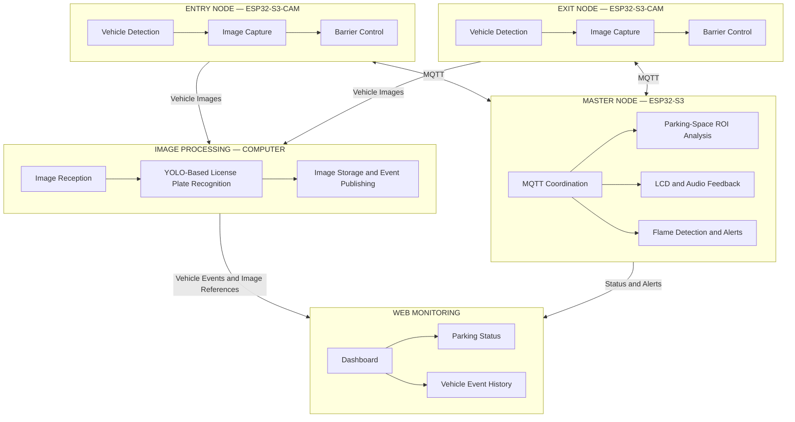

# 🚗 Design of a Smart Parking Management System Using Image Processing and IoT

An ESP32-S3-based smart parking management system integrating **embedded systems, computer vision, and IoT communication** to support automated vehicle entry and exit, parking-space monitoring, and safety alerts.

The system uses a **three-node architecture** consisting of an Entry Node, an Exit Node, and a Master Node. It combines ESP32-S3 camera modules, MQTT-based communication, Python-based image processing, and a web dashboard to provide an integrated smart parking management solution.

## 🖥️ Dashboard Preview

The web dashboard provides a centralized interface for monitoring parking-space occupancy, vehicle entry and exit, recognized license plates, recent events, and system alerts.


*Figure 1. Web dashboard for smart parking monitoring.*

## ✨ Key Features

- **License Plate Recognition:** Captures vehicle images at the entrance and exit and processes them using a YOLO-based recognition pipeline running on a computer.
- **Automated Barrier Control:** Controls servo-driven barriers based on vehicle entry and exit operations.
- **Parking-Space Monitoring:** Uses Region of Interest (ROI)-based image processing to analyze individual parking spaces.
- **MQTT-Based IoT Communication:** Exchanges images, vehicle events, and system information between the embedded nodes and software components.
- **Web-Based Monitoring:** Displays parking-space status, recognized license plates, and recent vehicle events.
- **Safety Monitoring:** Integrates flame detection with visual and audible alerts.
- **Hardware–Software Integration:** Combines camera modules, sensors, actuators, LCD, and audio feedback into a coordinated system.

## 🏗️ System Architecture

The system consists of three ESP32-S3-based nodes and a computer-based image-processing application connected to a web monitoring interface.



## 🔌 Hardware Implementation

The hardware is organized into three functional nodes, each responsible for a specific part of the smart parking management workflow.

The Entry Node and Exit Node handle vehicle image capture and barrier control, while the Master Node coordinates system functions, including display, audio feedback, and flame detection.


*Figure 2. Overall hardware prototype integrating the Entry Node, Exit Node, and Master Node.*

## 🔧 Hardware and Software Technologies

| Category | Technologies |
|---|---|
| Embedded platform | ESP32-S3, ESP32-S3-CAM |
| Firmware development | C/C++, Arduino framework |
| Image processing | Python, OpenCV, YOLO |
| Parking-space classification | TensorFlow/Keras |
| Communication | MQTT, Wi-Fi, JSON |
| Web development | HTML, CSS, JavaScript |
| Messaging infrastructure | MQTT broker (EMQX) |

## 🔄 System Workflow

1. **Vehicle Detection:** Sensors at the entrance or exit detect a vehicle.
2. **Image Capture:** The corresponding ESP32-S3-CAM captures a vehicle image.
3. **Image Transmission:** The image is transmitted to the computer-based processing application through MQTT.
4. **License Plate Recognition:** The Python application processes the image using a YOLO-based recognition pipeline.
5. **Data Storage:** The processed image and recognition results are saved for monitoring and reference.
6. **Event Publishing:** Vehicle entry or exit information is published through MQTT.
7. **Dashboard Update:** The web dashboard displays vehicle information, image references, and recent events.
8. **System Feedback:** The embedded nodes provide barrier control, LCD/audio feedback, and safety alerts.

## 🧪 Image Processing

The system uses computer-based image processing to recognize vehicle license plates from images captured at the entrance and exit.

The parking-space monitoring approach divides an overview image into predefined Regions of Interest (ROIs), with each ROI corresponding to an individual parking space. These regions can be analyzed to determine occupancy and support parking-condition assessment.

### License Plate Recognition

<!-- Replace this placeholder with a screenshot of the license plate recognition result -->


*Figure 3. Example of the license plate recognition result.*

### Parking-Space Monitoring

<!-- Replace this placeholder with a screenshot showing the parking-space ROIs and classification results -->


*Figure 4. Parking-space regions of interest used for occupancy monitoring.*

## 📊 Testing and Evaluation

The system is evaluated through functional tests covering embedded hardware, image processing, MQTT communication, and web monitoring.

| Test Item | Evaluation |
|---|---|
| Vehicle image capture | Verify image capture at the entrance and exit |
| License plate recognition | Evaluate recognition results using test images |
| MQTT communication | Verify image and event transmission |
| Barrier control | Test barrier operation during vehicle entry and exit |
| Dashboard monitoring | Verify vehicle information and event updates |
| Parking-space monitoring | Evaluate occupancy classification for each parking space |
| Safety alerts | Test flame detection and visual/audio notifications |

## 📈 Quantitative Results

Quantitative performance metrics should be added after testing the system with a sufficiently representative dataset.

| Metric | Result |
|---|---|
| License plate recognition accuracy | To be measured |
| Parking-space classification accuracy | To be measured |
| MQTT message delivery reliability | To be measured |
| Average image-processing time | To be measured |

*Note: Performance values should be reported based on actual experimental results.*

## 🎯 Project Objectives

- Design and integrate an ESP32-S3-based smart parking management system.
- Implement MQTT communication between embedded nodes and computer-based software.
- Develop a YOLO-based license plate recognition pipeline using Python.
- Build a web dashboard for parking and vehicle-event monitoring.
- Integrate barrier control and safety-alert functions.
- Develop an ROI-based approach for parking-space occupancy analysis.

## 💡 Technical Skills Demonstrated

- Embedded systems development using ESP32-S3
- C/C++ firmware development
- Python-based computer vision
- YOLO-based object and license plate recognition
- OpenCV image processing
- MQTT and IoT communication
- Web development using HTML, CSS, and JavaScript
- Hardware–software integration and system debugging
- Sensor and actuator interfacing
- System testing and evaluation

## 📁 Repository Structure

```text
Smart-Parking-Management-System/
├── firmware/
│   ├── entry_node/
│   ├── exit_node/
│   └── master_node/
├── image_processing/
├── web_dashboard/
├── docs/
│   └── images/
│       ├── hardware_overview.jpg
│       ├── license_plate_result.jpg
│       └── parking_roi_result.jpg
└── README.md
```

*Note: Adjust the directory structure to match the actual files in the repository.*

