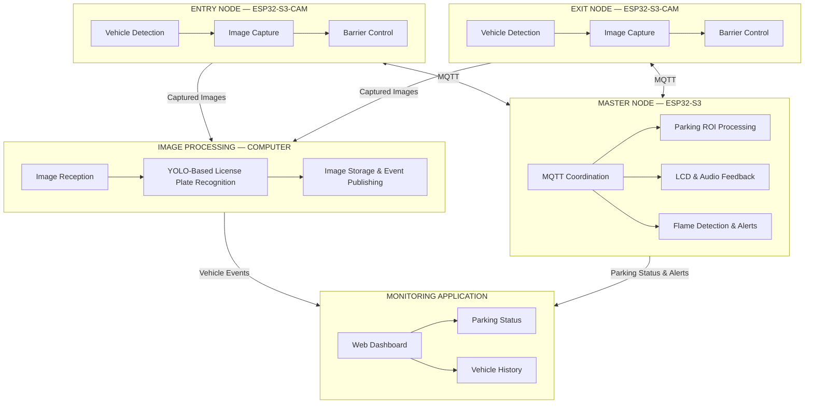

# 🚗 Design of a Smart Parking Management System Using Image Processing and IoT

An ESP32-S3-based smart parking management system that integrates **image processing, IoT communication, and real-time monitoring** to automate vehicle entry and exit, monitor parking-space occupancy, and provide safety alerts.

The system follows a **three-node architecture** consisting of two gate-control nodes and one master node, combining embedded hardware, a Python-based image-processing pipeline, and a web-based monitoring dashboard.

## ✨ Key Features

- **License Plate Recognition:** Captures vehicle images at the entrance and exit, then processes them using a YOLO-based recognition pipeline running on a computer.
- **Automated Gate Control:** Controls servo-driven barriers based on vehicle entry and exit events.
- **Parking Occupancy Monitoring:** Uses Region of Interest (ROI)-based image processing to analyze individual parking spaces.
- **IoT Communication:** Uses MQTT messaging to exchange images, vehicle events, and system status between embedded nodes and the monitoring application.
- **Real-Time Web Dashboard:** Displays parking-space status, recognized license plates, recent vehicle events, and system alerts.
- **Safety Monitoring:** Integrates a flame sensor with visual and audible alerts.
- **Embedded System Integration:** Combines ESP32-S3 camera modules, sensors, actuators, an LCD, and audio feedback into a coordinated system.

## 🏗️ System Architecture

## 🔧 Hardware & Software

| Category | Technologies |
|---|---|
| Embedded platform | ESP32-S3, ESP32-S3-CAM |
| Programming | C/C++, Python, JavaScript |
| Communication | MQTT, Wi-Fi, JSON |
| Computer vision | OpenCV, YOLO, ROI-based image processing |
| Machine learning | TensorFlow/Keras for parking-space classification |
| Web interface | HTML, CSS, JavaScript |
| Hardware peripherals | Camera, sensors, servo barrier, LCD, buzzer/audio module |

## 🔄 System Workflow

1. **Vehicle detection:** The ENTRY or EXIT node detects a vehicle and captures an image.
2. **Image transmission:** The captured image is transmitted through MQTT to the image-processing application.
3. **License plate recognition:** The Python application processes the image, recognizes the license plate, and saves the result.
4. **Event communication:** Vehicle information and image references are published for the monitoring application.
5. **Parking-space analysis:** The master-side processing workflow analyzes predefined parking ROIs to determine occupancy and support parking-position assessment.
6. **Monitoring and alerts:** The dashboard presents vehicle events and parking status, while the master node coordinates display, audio feedback, and safety alerts.

## 🎯 Project Objectives

- Develop a multi-node embedded system using ESP32-S3.
- Integrate image processing with MQTT-based IoT communication.
- Coordinate vehicle entry and exit operations with barrier control.
- Build a centralized monitoring interface for parking spaces and vehicle events.
- Integrate environmental sensing and alert mechanisms.
- Explore ROI-based image analysis for parking occupancy and parking-position assessment.

## 👨‍💻 My Technical Focus

This project involves practical experience in:

- Embedded firmware development and peripheral integration.
- MQTT-based communication between distributed IoT nodes.
- Python-based image-processing integration.
- Hardware–software debugging and system-level integration.
- Web-based monitoring and visualization of IoT events.

---

**Project domain:** Embedded Systems · Computer Vision · IoT · System Integration
