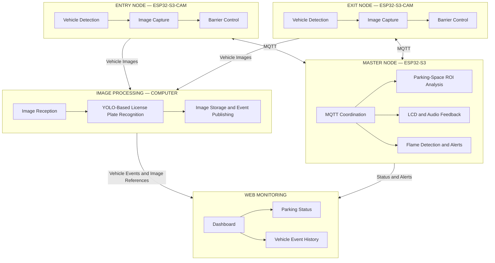

# 🚗 Design of a Smart Parking Management System Using Image Processing and IoT

An ESP32-S3-based smart parking management system integrating **embedded systems, computer vision, and IoT communication** to support automated vehicle entry and exit, parking-space monitoring, and safety alerts.

The system uses a **three-node architecture** consisting of an Entry Node, an Exit Node, and a Master Node. It combines ESP32-S3 camera modules, MQTT-based communication, Python-based image processing, and a web dashboard to provide an integrated smart parking management solution.

## 🖥️ Dashboard Preview

The web dashboard provides a centralized interface for monitoring parking-space occupancy, vehicle entry and exit, recognized license plates, recent events, and system alerts.

<!-- Replace the placeholder below with your actual dashboard screenshot -->

*Figure 1. Web dashboard for smart parking monitoring.*

## ✨ Key Features

- **License Plate Recognition:** Captures vehicle images at the entrance and exit and processes them using a YOLO-based recognition pipeline running on a computer.
- **Automated Barrier Control:** Controls servo-driven barriers based on vehicle entry and exit operations.
- **Parking-Space Monitoring:** Uses Region of Interest (ROI)-based image processing to analyze individual parking spaces.
- **MQTT-Based IoT Communication:** Exchanges images, vehicle events, and system information between the embedded nodes and software components.
- **Web-Based Monitoring:** Displays parking-space status, recognized license plates, and recent vehicle events.
- **Safety Monitoring:** Integrates flame detection with visual and audible alerts.
- **Hardware–Software Integration:** Combines camera modules, sensors, actuators, LCD, and audio feedback into a coordinated system.

## 🏗️ System Architecture

The system consists of three ESP32-S3-based nodes and a computer-based image-processing application connected to a web monitoring interface.

## 🔌 Hardware Implementation

The hardware is organized into three functional nodes, each responsible for a specific part of the parking management workflow.

### Entry Node

Responsible for capturing vehicle images and controlling the entrance barrier.

<!-- Replace with an actual photo of the Entry Node -->

*Figure 2. Entry Node based on ESP32-S3-CAM.*

### Exit Node

Responsible for capturing vehicle images and controlling the exit barrier.

<!-- Replace with an actual photo of the Exit Node -->

*Figure 3. Exit Node based on ESP32-S3-CAM.*

### Master Node

Coordinates system functions, including parking-space monitoring, display, audio feedback, and flame detection.

<!-- Replace with an actual photo of the Master Node -->

*Figure 4. Master Node and its connected peripherals.*

### Complete Prototype

<!-- Replace with an actual photo of the complete physical prototype -->

*Figure 5. Overall hardware prototype of the smart parking system.*

## 🔧 Hardware and Software Technologies

| Category | Technologies |
|---|---|
| Embedded platform | ESP32-S3, ESP32-S3-CAM |
| Firmware development | C/C++, Arduino framework |
| Image processing | Python, OpenCV, YOLO |
| Parking-space classification | TensorFlow/Keras |
| Communication | MQTT, Wi-Fi, JSON |
| Web development | HTML, CSS
